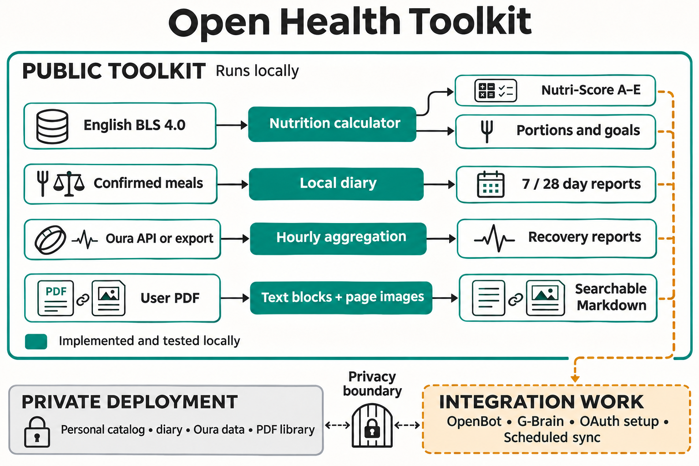

# Open Health Toolkit

A local Python toolkit for food composition, nutrition calculations, Oura exports and illustrated health references. Its calculations can run from the command line or behind an agent. The included example product and telemetry are synthetic.



## Quick start

Requires Python 3.11 or newer. The core uses the standard library.

```sh
python -m pip install .
health-toolkit find 'green sweet pepper' --kind ingredient
health-toolkit calculate --json '{"food_id":"bls-G541100","grams":75}'
health-toolkit --catalog examples/product.jsonl calculate \
  --json '{"food_id":"user-example-soup","serving_fraction":0.5}'
```

For use without installing, replace `health-toolkit` with `python -m health_toolkit` from the repository root. Put global options such as `--catalog` and `--diary` before the subcommand.

| Component | What you can run |
| --- | --- |
| Food reference and user catalog | English BLS 4.0 lookup, source records, explicit food types, a separate local product file |
| Nutrition | Portion and recipe maths, explicit goal assessment, Nutri-Score, an SQLite diary and 7/28-day nutrition summaries |
| Oura | API v2 reading with your access token, local normalization and 7/28-day coverage summaries |
| Illustrated references | PDF text and coordinates, page images, optional OCR, Markdown with page references |
| Agents and retrieval | English agent instructions and interface examples for a user-configured OpenBot and G-Brain setup |

- [Nutrition quick start and input contracts](docs/nutrition.md)
- [Nutri-Score method and evidence](docs/nutri-score.md)
- [Oura and document setup](docs/sources.md)
- [Architecture, agent integration and deployment boundaries](docs/architecture.md)
- [Release checks](docs/release.md)

## Verification

```sh
python -m unittest discover -s tests -v
```

Install Poppler for the PDF integration test. Tesseract is optional at runtime and requires the requested language data. Oura tests use synthetic responses.

Code and documentation are under the [MIT license](LICENSE). The bundled BLS data are under [CC BY 4.0, with attribution and transformation details](health_toolkit/data/ATTRIBUTION.md).
