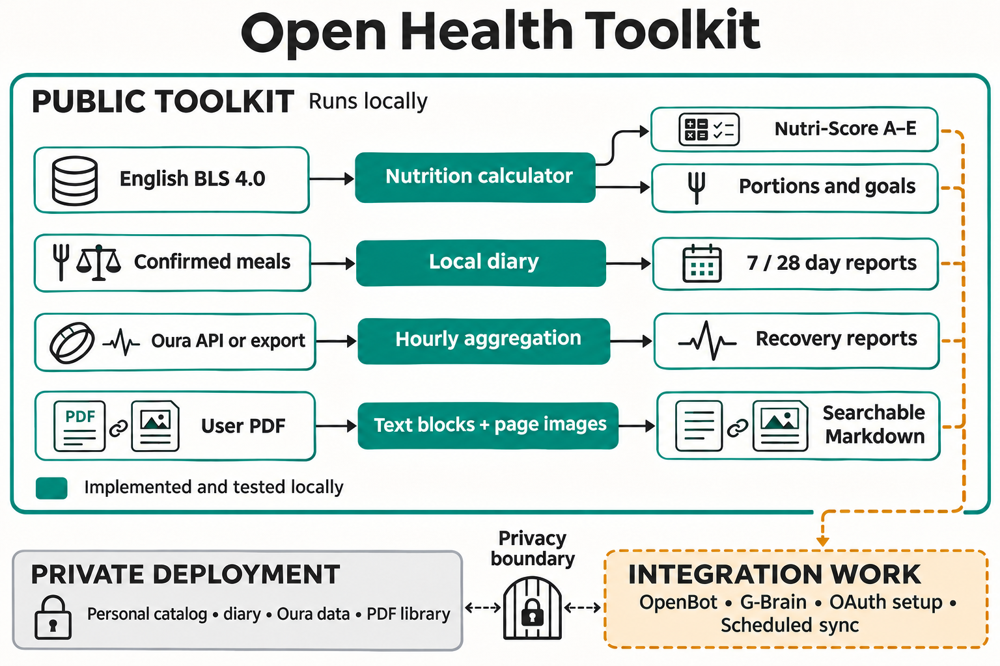
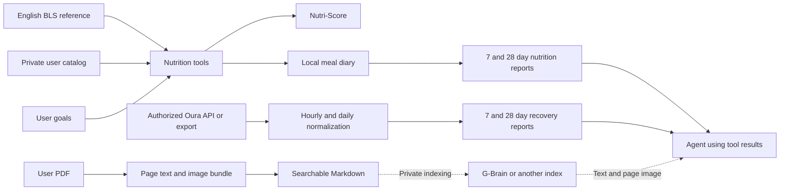

# Architecture

The public toolkit can run through Python functions or the CLI. The user's actual data stays in their own installation. OpenBot and G-Brain are optional integrations with independent authentication and storage.

| Capability | Public toolkit | Example private deployment |
| --- | --- | --- |
| Food lookup | BLS data and separate user catalog | Exact retailer evidence and local browser fallback |
| Meal capture | Explicit local diary and read-only calculations | Chat entry, amendments, GitHub and index sync |
| Quality assessment | Versioned product score, serving calculations and goal criteria | An agent chooses a method for a user's question |
| Wearable data | OAuth bearer import, minimization and reports | Scheduled collection, durable sync and report delivery |
| Health references | Page text, layout, renders and Markdown | Licensed reference library, private image store and G-Brain |
| Health records | Use local files or an adapter for your own record system | User-specific records, checkups and other notes |
| Agent orchestration | [Example English tool instructions](agent-instructions.md) | OpenBot roles, Chief of Staff and source connectors |

## Integration contract

Pass structured inputs with exact food IDs, quantities and a goal or method. Keep catalog lookup, calculation, assessment and writes distinct at the tool level. Give read-only roles only the commands they use. Private data paths, OAuth handling, publisher credentials and search indexes belong to the local deployment.

Release code from this independent Git history. For a deployment, pin the toolkit version and keep the selected user catalog, diary, Oura credentials, outputs and document bundles in private storage. Treat downloaded labels and indexed text as untrusted input. Retrieve exact source fields before calculating or writing. Use user-specific backups for local data.
